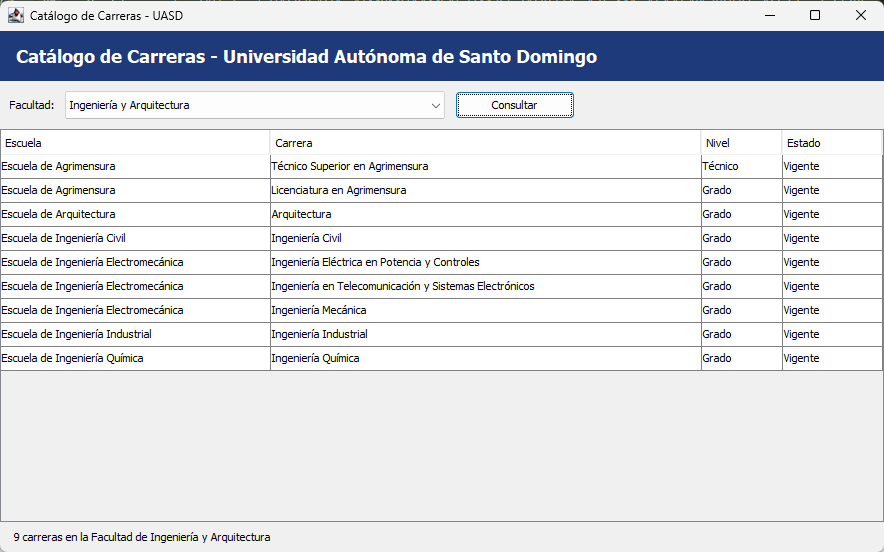

# Catálogo de Carreras de la UASD

Programa en **Java** (ventana con Swing) que consulta, en una base de datos **SQL Server**, el catálogo de carreras ofertadas por la Universidad Autónoma de Santo Domingo. Se elige una facultad, se pulsa **Consultar** y la tabla muestra sus escuelas y carreras.

Trabajo Final de Conectividad a Bases de Datos, Sección 20.



## Qué necesitas tener

| Requisito | Para qué | Cómo comprobarlo |
|---|---|---|
| **JDK 17 o superior** (se probó con JDK 21) | Compilar y ejecutar Java | `java -version` y `javac -version` |
| **SQL Server** accesible por TCP en `localhost:1433` | Guardar el catálogo | Ver el paso 2 |

El driver de SQL Server ya viene en el proyecto, en la carpeta `lib`. No hay que descargar nada más.

## Instalación y ejecución

### 1. Descargar el proyecto

```
git clone <URL-DEL-REPOSITORIO>
cd catalogo-carreras-uasd
```

### 2. Tener un SQL Server encendido

**SQL Server Express instalado en tu PC (como en el blog de la clase)**

1. Descarga **SQL Server Express** (gratis) desde microsoft.com/sql-server/sql-server-downloads e instálalo. Si tu Windows está en español, descarga el instalador **en español**: uno en inglés falla con "does not support the language of the OS". En *Database Engine Configuration* elige **Mixed Mode** (autenticación mixta) y ponle a `sa` la clave `Catalogo_UASD_2026`.
2. Abre *SQL Server Configuration Manager* (`Windows + R`, escribe `SQLServerManager16.msc`). Entra en *SQL Server Network Configuration → Protocols for SQLEXPRESS → TCP/IP* y ponlo en **Enabled**. En la pestaña *IP Addresses*, baja a **IPAll**, deja vacío *TCP Dynamic Ports* y pon *TCP Port* = `1433`. Es el mismo procedimiento del blog de la clase ("Conectar SQL Server con Java").
3. En *SQL Server Services*, clic derecho sobre **SQL Server (SQLEXPRESS)** y **Restart**. Si otro programa ocupa el puerto 1433, ciérralo antes.

Con eso el programa funciona sin cambiar nada: usuario `sa` y clave `Catalogo_UASD_2026` ya están en `src/uasd/catalogo/conexion/ConexionBD.java`. Si prefieres otra clave, cámbiala en `CLAVE`.

> LocalDB no sirve para este programa: el driver JDBC solo se conecta por TCP/IP.

**No hace falta crear la base de datos ni importar nada.** Al arrancar, el programa crea la base `CatalogoUASD` y carga los datos, solo si no existen todavía. Para hacerlo, lee los scripts de la carpeta `sql/`.

### 3. Ejecutar

Desde la carpeta del proyecto, en PowerShell o CMD:

```
.\ejecutar.bat
```

`ejecutar.bat` compila el programa (con `compilar.bat`) y lo arranca. La primera vez, el programa crea la base y carga los datos. Después abre la ventana.

**Los dos comandos a mano**, que es lo que hace `ejecutar.bat`:

```
javac -encoding UTF-8 -sourcepath src -d build\classes -cp lib\mssql-jdbc-12.8.1.jre11.jar src\uasd\catalogo\Main.java
java -cp "build\classes;lib\mssql-jdbc-12.8.1.jre11.jar" uasd.catalogo.Main
```

El programa lee los scripts de la carpeta `sql/` con una ruta relativa, así que debe ejecutarse desde la carpeta del proyecto. En Linux o macOS los separadores cambian (`/` en las rutas y `:` en el classpath); esa forma no se probó.

**En NetBeans** (como en los videos y el blog de la clase). El proyecto ya trae sus archivos de NetBeans, así que no hay que configurar nada:
1. *File → Open Project*, elige la carpeta `catalogo-carreras-uasd` y pulsa **Open Project**.
2. Enciende SQL Server (paso 2) y pulsa el botón verde (*Run*).

Se probó en Apache NetBeans 31 con JDK 21. El proyecto compila para Java 11, así que sirve con cualquier JDK 11 o superior. NetBeans 8.2 trabaja con Java 8, y este proyecto necesita Java 11 o superior.

**Para crear el proyecto de NetBeans desde cero** (como en los videos):
1. *File → New Project* (`Ctrl + Shift + N`). En *Categories* elige **Java with Ant** y, a la derecha, **Java Project with Existing Sources**.
2. En *Name and Location* elige la carpeta del proyecto. Si ya existe una carpeta `build`, NetBeans no deja continuar: bórrala.
3. En *Existing Sources* agrega la carpeta `src` y pulsa **Finish**.
4. Clic derecho sobre **Libraries**, **Add JAR/Folder...** y elige `lib\mssql-jdbc-12.8.1.jre11.jar`. Sin este paso el programa falla con "No se encontró el driver de SQL Server".
5. Clic derecho sobre el proyecto, **Properties → Run → Main Class**, y elige `uasd.catalogo.Main`.

NetBeans y `compilar.bat` usan la misma carpeta de salida (`build\classes`), así que no los uses a la vez.

### 4. Usarlo

1. Elige una **Facultad** en la lista.
2. Pulsa **Consultar**.
3. La tabla muestra las carreras de esa facultad con su escuela, nivel (Técnico o Grado) y estado (Vigente o Proyectada). Un clic en el encabezado de una columna ordena la tabla.

## Documentación

Guías en HTML, dentro de la carpeta `docs/`. Descárgalas y ábrelas con doble clic en el navegador (GitHub las muestra como código, no como página):

| Archivo | Qué explica |
|---|---|
| `docs/TUTORIAL-PASO-A-PASO.html` | Cómo se construyó el proyecto, paso a paso, en NetBeans |
| `docs/TUTORIAL-PASO-A-PASO-TERMINAL.html` | Lo mismo, con la terminal y los archivos `.bat` |
| `docs/PASO-A-PASO-Y-TECNICAS.html` | Las técnicas de programación usadas y en qué archivo y línea está cada una |
| `docs/EXPLICACION.md` | Resumen para la exposición |
| `docs/codigo-fuente.pdf` | Código fuente y capturas |

## Configuración

Los datos de conexión son constantes al inicio de `src/uasd/catalogo/conexion/ConexionBD.java`:

| Constante | Valor por defecto | Significado |
|---|---|---|
| `SERVIDOR` | `jdbc:sqlserver://localhost:1433;encrypt=true;trustServerCertificate=true` | Dónde está el servidor |
| `USUARIO` | `sa` | Usuario de SQL Server |
| `CLAVE` | `Catalogo_UASD_2026` | Clave del usuario |
| `BASE` | `CatalogoUASD` | Nombre de la base de datos del catálogo |

La clave `Catalogo_UASD_2026` es solo para pruebas locales de este trabajo. No la uses en un servidor real.

## Dependencias

| Dependencia | Versión | Para qué | Quién la instala |
|---|---|---|---|
| JDK (Java Development Kit) | 17 o superior | Compilar y ejecutar | Tú |
| SQL Server | 2019 o superior (se probó Express 2022) | Base de datos | Tú |
| `mssql-jdbc` (driver JDBC de Microsoft, un archivo JAR) | 12.8.1.jre11 | Conectar Java con SQL Server | Ya viene en `lib/` |
| Swing | Viene con el JDK | Ventana, combo, botón y tabla | Nada que instalar |
| NetBeans (opcional) | Se probó la 31, con JDK 21 | Abrir y ejecutar el proyecto, como en los videos de la clase | Tú |

## Estructura del proyecto

```
catalogo-carreras-uasd/
├─ README.md                  este archivo
├─ compilar.bat               compila el programa
├─ ejecutar.bat               compila y ejecuta el programa
├─ build.xml, manifest.mf     archivos de NetBeans
├─ nbproject/                 configuración del proyecto de NetBeans
├─ lib/
│  └─ mssql-jdbc-12.8.1.jre11.jar   driver de SQL Server
├─ sql/
│  ├─ 01_esquema.sql          crea las tablas facultad, escuela y carrera
│  └─ 02_datos.sql            datos oficiales del catálogo UASD
├─ docs/
│  ├─ EXPLICACION.md          explicación para la exposición
│  ├─ *.html                  guías paso a paso y técnicas (se abren en el navegador)
│  ├─ codigo-fuente.pdf       código fuente y capturas (entrega en PDF)
│  └─ capturas/               pantallazos del programa corriendo
└─ src/uasd/catalogo/
   ├─ Main.java               punto de entrada
   ├─ modelo/                 EntidadCatalogo, Facultad, Carrera, CarreraTecnica,
   │                          CarreraGrado, NivelCarrera
   ├─ dao/                    interfaces y clases que consultan con JDBC
   ├─ conexion/               ConexionBD e InicializadorBD
   └─ formularios/            Frm_Carreras.java y Frm_Carreras.form (formulario de Swing,
                              hecho con el diseñador de NetBeans)
```

Las carpetas `build/` y `dist/` aparecen solas al compilar y no se suben a GitHub. Tampoco `nbproject/private/`, que guarda rutas de tu computadora.

## Solución de problemas

| Síntoma | Causa probable | Qué hacer |
|---|---|---|
| "No se pudo preparar la base de datos" al abrir | SQL Server apagado o datos de conexión incorrectos | Enciende SQL Server y revisa los datos en `ConexionBD.java` |
| `Connection refused` en la consola | TCP/IP desactivado, puerto distinto de 1433, o servicio sin reiniciar | Activa TCP/IP en el puerto 1433 (paso 2) y reinicia el servicio |
| `Login failed for user 'sa'` | La clave de `sa` no es la de `ConexionBD.java` | Usa la misma clave en SQL Server y en `ConexionBD.java` |
| El puerto 1433 está ocupado | Otro programa lo usa (por ejemplo otra instancia de SQL Server) | Ciérralo y reinicia el servicio de SQL Server |
| `'javac' no se reconoce` o `'java' no se reconoce` | No hay JDK 17+ en el PATH | Instala un JDK (por ejemplo Eclipse Temurin 21) y abre una terminal nueva |
| `No se encontró sql\01_esquema.sql` | El programa se ejecutó desde otra carpeta | Usa `.\ejecutar.bat`, que se ubica solo en la carpeta del proyecto |
| `No suitable driver found` | Falta el JAR del driver o no está en el classpath | Verifica que exista `lib\mssql-jdbc-12.8.1.jre11.jar` y ejecuta con `ejecutar.bat` |
| La ventana abre pero el combo está vacío | La base existe pero sin datos | Borra la base `CatalogoUASD` y vuelve a ejecutar |

## Fuente de los datos

Catálogo oficial de la UASD: <https://uasd.edu.do/wp-content/uploads/catalogo-oferta-academica-agosto30.pdf> (edición 2024). Incluye las 9 facultades con sus escuelas y 140 carreras de nivel Técnico y Grado. El postgrado (especialidades, maestrías y doctorados) no se incluye. El propio catálogo es provisional y la UASD lo actualiza cada semestre.
